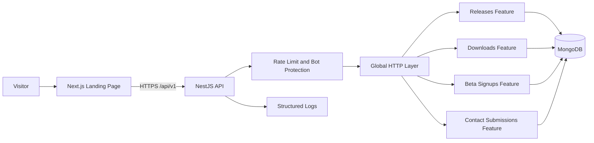
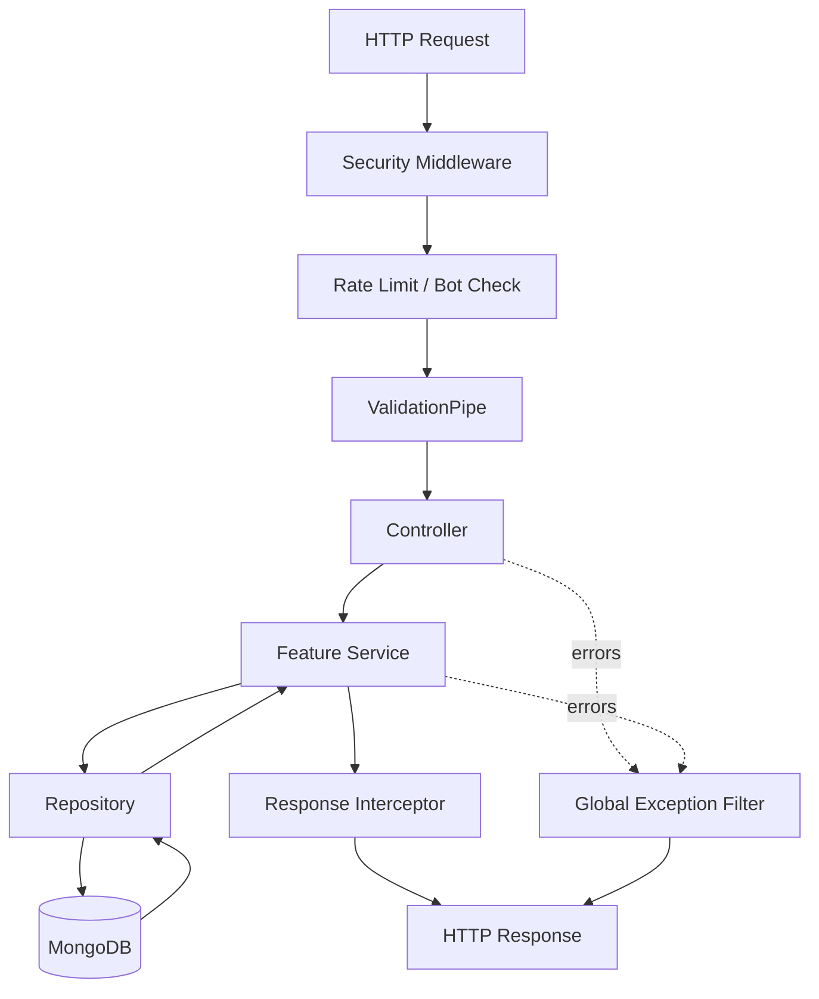

# Backend Architecture — HideAuto Landing Page
## 1. Scope

- This NestJS backend supports the public HideAuto landing page.
- It provides release metadata, download-event recording, beta signup, contact submission, and health-check APIs.
- It does not run browser automation or store desktop-product data such as workflows, profiles, cookies, credentials, schedules, or execution logs.
- The architecture is a feature-based monolith: one deployable NestJS application with isolated business features.
## 2. System Overview


### Why feature-based

- Each business capability owns its HTTP contract, validation, business rules, database access, and tests.
- A change to beta signup should not require touching release or contact internals.
- The structure stays understandable for a one-person team and can scale to more contributors without becoming layer-based.
- Shared code remains small and technical; product decisions stay in their owning feature.
## 3. Runtime Architecture



- **Middleware:** request ID, CORS, security headers, and raw request limits.
- **Guards:** authorization for future admin routes only.
- **Pipes:** DTO transformation and validation.
- **Interceptors:** response envelope, request duration, and safe logging context.
- **Filters:** map known errors to the public API error contract.
## 4. Folder Structure

```text
src/
├── main.ts                           # Bootstrap, global HTTP configuration
├── app.module.ts                      # Root module composition
├── config/
│   ├── env.validation.ts              # Environment schema
│   ├── app.config.ts                  # App, CORS, and API settings
│   ├── database.config.ts             # MongoDB settings
│   └── security.config.ts             # Rate limits and trusted origins
├── core/
│   ├── database/
│   │   ├── database.module.ts         # Mongoose connection
│   │   └── migrations/                # Versioned MongoDB migrations
│   ├── http/
│   │   ├── filters/                   # Global exception filter
│   │   ├── interceptors/              # Response and logging interceptors
│   │   └── types/                     # API response/error types
│   └── logger/                        # Structured logger configuration
├── shared/
│   ├── constants/                     # Reusable non-business constants
│   ├── decorators/                    # Reusable NestJS decorators
│   ├── guards/                        # Reusable authorization guards
│   ├── types/                         # Shared TypeScript types
│   └── utils/                         # Pure utilities
└── features/
    ├── health/
    ├── releases/
    ├── downloads/
    ├── beta-signups/
    └── contact-submissions/
```

- `config` reads and validates environment variables; it contains no business logic.
- `core` initializes infrastructure used by the whole application.
- `shared` contains reusable code with no dependency on a specific feature.
- `features` owns all landing-page business capabilities.
## 5. Feature Anatomy

```text
features/releases/
├── controllers/
│   └── releases.controller.ts         # Routes and DTO mapping only
├── dto/
│   ├── get-latest-release.query.dto.ts
│   └── release-response.dto.ts
├── repositories/
│   └── app-release.repository.ts      # Mongoose queries only
├── schemas/
│   └── app-release.schema.ts          # Collection schema and indexes
├── services/
│   └── releases.service.ts            # Availability and selection rules
├── types/
│   └── release-channel.enum.ts
├── tests/
│   ├── releases.service.spec.ts
│   └── releases.controller.e2e-spec.ts
├── context.md                         # Feature purpose and public contract
└── releases.module.ts                 # Dependency injection boundary
```

- Create `mappers/` or `utils/` only when a feature has a real need; do not add empty folders.
- A schema belongs to the same feature as the collection defined in `DATABASE.md`.
- Feature modules import only infrastructure modules, shared modules, and public modules from other features.
## 6. Feature Responsibilities

| Feature | Owns | MongoDB collection |
| --- | --- | --- |
| `health` | Liveness/readiness endpoints | None |
| `releases` | Published release lookup and admin release management | `app_releases` |
| `downloads` | Validate requested release and record minimal download events | `download_events` |
| `beta-signups` | Consent-aware beta registration and unsubscribe state | `beta_signups` |
| `contact-submissions` | Validated contact/feedback messages and moderation state | `contact_submissions` |
## 7. Request Flow

```text
Request
  -> middleware / rate limiting
  -> global DTO validation
  -> controller
  -> service
  -> repository
  -> MongoDB
  -> service
  -> response interceptor
  -> response
```

- **Controller:** declares routes, receives validated DTOs, calls one service method, and returns a typed response.
- **Service:** applies feature rules, idempotency, cross-feature coordination, and domain error decisions.
- **Repository:** performs Mongoose queries, applies projections and soft-delete filters, and has no HTTP concerns.
- **Response interceptor:** wraps successful responses as `{ success: true, data, meta? }`.
- **Exception filter:** wraps failures as `{ success: false, error: { code, message, details? } }`.

Example: `POST /api/v1/beta-signups` validates email/consent → `BetaSignupsService` normalizes the email and handles duplicates → `BetaSignupRepository` persists the document → API returns `201 Created`.
## 8. Cross-Feature Communication

- Allowed:

  - Dependency injection of a service explicitly exported by another feature module.
  - Typed domain events for optional asynchronous effects.
  - Shared utilities for generic, stateless behavior.

- Forbidden:

  - Importing another feature's schema, repository, DTO, private service, or internal file.
  - Direct Mongoose model access outside the owning feature repository.
  - Circular module dependencies and routine use of `forwardRef()`.

Example: `DownloadsService` injects the public `ReleasesService` to validate an active release. It does not query the `app_releases` collection directly.
## 9. Shared vs Core

| Shared | Core |
| --- | --- |
| Stateless utilities | MongoDB connection and migrations |
| Common types and constants | HTTP exception and response infrastructure |
| Reusable decorators and guards | Logger configuration |
| Generic sanitization helpers | Configuration loading and validation |

- If a file contains release, download, signup, or contact business vocabulary, it belongs in that feature—not `shared` or `core`.
## 10. Configuration Management

- Read configuration only through NestJS `ConfigService` and typed config factories.
- Validate required variables during bootstrap; fail fast when values are missing or invalid.
- Use `.env.example` for variable names and harmless example values; never commit `.env` files.

| Variable | Purpose |
| --- | --- |
| `NODE_ENV` | Runtime environment |
| `PORT` | API port |
| `MONGODB_URI` | MongoDB connection string |
| `CORS_ORIGINS` | Allowed Next.js origins |
| `RATE_LIMIT_TTL` / `RATE_LIMIT_LIMIT` | Public API throttling |
| `DOWNLOAD_EVENT_RETENTION_DAYS` | TTL retention period |
| `LOG_LEVEL` | Structured logging level |

- Keep secrets in the deployment secret manager, not source code, browser-visible variables, or logs.
- Any service credentials for email, CAPTCHA, or analytics must be server-only and feature-scoped.
## 11. Deployment Notes

- Deploy Next.js and NestJS independently; the frontend uses only public, versioned API endpoints.
- Run database migrations before starting the new API version.
- Configure TLS, CORS allowlists, request-size limits, rate limits, and health probes at deployment.
- MongoDB stores landing-page operational data only; release binaries are stored in object storage or a release provider, not MongoDB.

