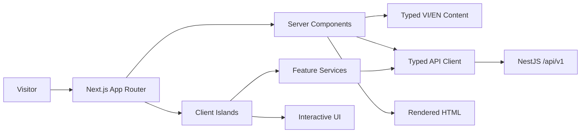
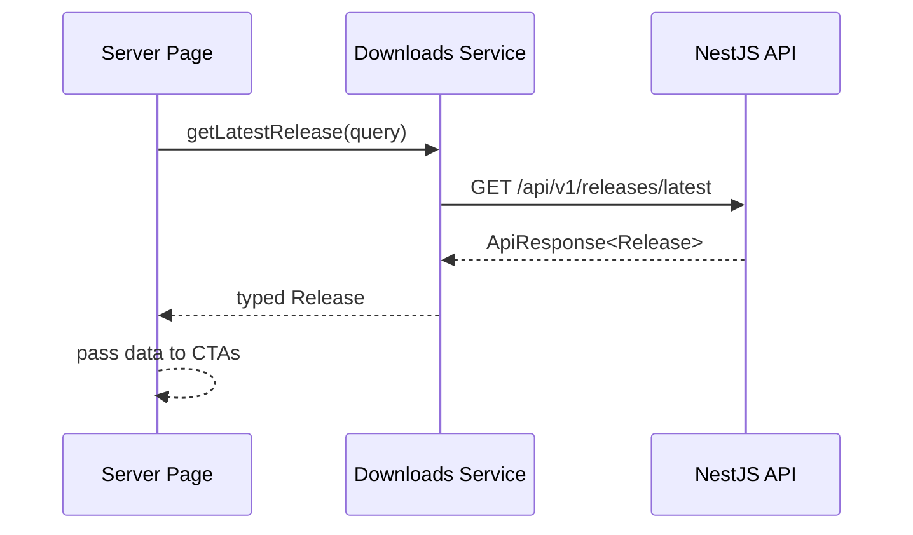

# Frontend Architecture — HideAuto Landing Page
## 1. Overview

- **Framework:** Next.js App Router, React, and TypeScript.
- **Styling:** Tailwind CSS backed by design tokens from `DESIGN.md`.
- **Rendering:** Server Components by default; Client Components at interactive boundaries.
- **State:** React local state first; Context only for locale and theme.
- **API access:** Typed native `fetch` wrapper following `API_SPEC.md`.
- **Organization:** Feature-based monolith with public feature entry points.

### Why this architecture

- Server rendering delivers fast first content, metadata, and crawlable marketing copy.
- Typed API boundaries keep the Next.js frontend aligned with the NestJS backend.
- Tailwind utilities plus centralized tokens preserve the Claude Design visual language consistently.
## 2. High-Level Architecture



- Server Components compose page sections and fetch initial release information.
- Client islands handle navigation menu, theme/language switches, tabs, accordions, and forms.
## 3. Folder Structure

```text
src/
├── app/
│   ├── [locale]/
│   │   ├── layout.tsx                 # Locale shell and metadata
│   │   ├── page.tsx                   # Landing-page feature composition
│   │   ├── loading.tsx                # Stable route fallback
│   │   └── error.tsx                  # Route error boundary
│   ├── layout.tsx                     # Root document, fonts, providers
│   ├── globals.css                    # Tokens, reset, base/grid styles
│   ├── robots.ts                      # Search crawler policy
│   └── sitemap.ts                     # Localized public URLs
├── features/
│   ├── navigation/                    # Header, mobile menu, active section
│   ├── hero/                          # Hero copy and calls to action
│   ├── product-preview/               # Cockpit and preview tabs
│   ├── features-overview/             # Operating-loop content
│   ├── critic/                        # Critic explanation and score model
│   ├── comparison/                    # Product comparison matrix
│   ├── pricing/                       # Beta plan and CTA
│   ├── faq/                           # Accessible accordion
│   ├── downloads/                     # Release lookup and download action
│   └── contact/                       # Signup/contact form behavior
├── shared/
│   ├── components/                    # Button, Container, SectionHeading
│   ├── hooks/                         # Generic UI/browser hooks
│   ├── providers/                     # Theme and locale providers
│   ├── services/                      # Base API client
│   ├── types/                         # API envelope and common types
│   └── utils/                         # Pure formatting/sanitizing helpers
├── content/
│   ├── vi.ts                          # Vietnamese source copy
│   ├── en.ts                          # English copy
│   └── content.types.ts               # Required content shape
└── assets/
    ├── icons/                         # Local SVG icons
    └── images/                        # Optimized product previews
```

- `app/[locale]/page.tsx` composes features but does not contain their detailed markup.
- No `pages/` directory is used because the project uses App Router.
- Add folders only when they contain real code; do not scaffold empty `stores/` or `utils/`.
## 4. Feature Anatomy

```text
features/downloads/
├── components/
│   └── DownloadButton.tsx             # User-facing download action
├── hooks/
│   └── useDownload.ts                 # Client mutation state
├── services/
│   └── downloads.service.ts           # Release and event API calls
├── types/
│   └── release.types.ts               # Feature API/domain types
├── tests/
│   ├── DownloadButton.test.tsx
│   └── downloads.service.test.ts
├── index.ts                           # Public exports
└── context.md                         # Ownership and public contract
```

- Presentational features may omit `hooks/` and `services/`.
- Feature-private components are never exported from `index.ts` unless another feature has a valid dependency.
- Forms keep Zod schemas inside their owning feature.
## 5. Data Flow

### Initial release data



### Client mutation

```text
User action -> Client component -> Feature hook -> Feature service
            -> Typed API client -> NestJS API -> Hook state -> UI feedback
```

- Components never call `fetch` directly.
- Services translate feature input into API requests and return validated typed results.
- Hooks own pending/success/error state for form and download mutations.
- Server-fetched data is passed down; it is not copied into a global client store.
## 6. State Management

| State type | Location | Example |
| --- | --- | --- |
| Static content | `src/content` | VI/EN hero and FAQ copy |
| Server data | Server Component / Next.js cache | Latest beta release |
| URL state | Locale segment and hash | `/vi`, `#pricing` |
| Global UI | Narrow React Context | Theme and hydrated locale preferences |
| Feature state | Feature hook | Signup request status |
| Local UI | Component `useState` | Active preview tab, open FAQ item |
| Authentication | Not applicable | Public landing page has no user auth |

- Do not introduce Redux, Zustand, or TanStack Query unless later requirements justify client-wide server-state coordination.
- Keep theme/locale defaults deterministic during server rendering to prevent hydration mismatch.
## 7. Cross-Feature Communication

| Method | Use case |
| --- | --- |
| Page composition and props | Share release data with hero, pricing, and closing CTA |
| Public feature export | Reuse an intentional feature-level component/service |
| URL/hash | Locale and section navigation |
| Narrow Context | Theme and locale UI state |
| Custom browser events | Avoid; use only for isolated third-party integration |

- Import feature code only through `@/features/<feature>`.
- Do not import another feature's components, hooks, services, or types by internal path.
- Shared business state is coordinated by the page, not a generic event bus.
## 8. Routing and Rendering

| Route | Access | Rendering | Purpose |
| --- | --- | --- | --- |
| `/` | Public | Redirect | Resolve default locale |
| `/vi` | Public | Static/ISR | Vietnamese landing page |
| `/en` | Public | Static/ISR | English landing page |

- There are no protected frontend routes in the landing-page scope.
- Generate localized metadata, canonical URLs, Open Graph data, and structured data on the server.
- Prefer static generation; revalidate only the release-dependent data when required.
- Lazy-load the heavy cockpit preview with `next/dynamic` when it materially improves bundle size.
- Do not lazy-load above-the-fold heading, primary CTA, or navigation.
## 9. API Layer

```text
shared/services/api-client.ts
    -> features/<feature>/services/*.service.ts
        -> server component or feature hook
            -> feature component
```

- `api-client.ts` owns base URL, JSON parsing, timeouts, and normalized `ApiError` handling.
- Feature services own endpoints and request/response types from `API_SPEC.md`.
- Public environment variables may contain only browser-safe values such as `NEXT_PUBLIC_API_BASE_URL`.
- Server-only configuration must not use the `NEXT_PUBLIC_` prefix.
- Treat network responses as untrusted and validate critical payloads before use.
## 10. Shared vs Features

| Shared | Features |
| --- | --- |
| Generic Button and Container | Hero CTA and pricing card |
| Base API client and envelope types | Download/contact services |
| Theme/locale providers | FAQ and preview state |
| Generic accessibility hooks | Feature-specific interaction hooks |
| Pure formatting utilities | Critic score presentation |

- A component moves to `shared` only after two features require the same behavior and visual contract.
- Design-specific business language belongs to its feature, even when the markup looks reusable.
## 11. Styling and Resilience

- Map `DESIGN.md` tokens to CSS variables and Tailwind utilities; use Barlow and Barlow Condensed through `next/font`.
- Use mobile-first layouts at `<768px`, `768–1023px`, and `>=1024px`; preserve accessible cockpit/table overflow.
- Respect reduced motion, visible focus, semantic landmarks, and 44x44px touch targets.
- Forms show inline feedback; route failures use `app/[locale]/error.tsx` without exposing internals.
- Release API failure disables download safely; analytics failure must not block an available download.

