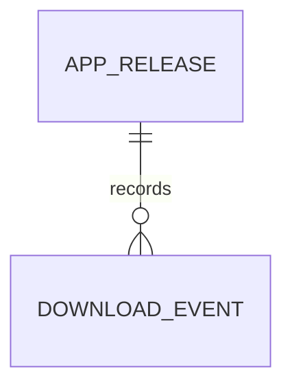

# HideAuto Landing Page Database

## 1. Overview

- **Scope:** Public HideAuto landing page only.
- **Database:** MongoDB 8.x.
- **Backend:** NestJS with TypeScript.
- **ODM:** Mongoose through `@nestjs/mongoose`.
- **Purpose:** Store release metadata, beta registrations, contact messages, and privacy-safe download events.
- **Out of scope:** Workflows, browser profiles, cookies, credentials, Critic reports, schedules, screenshots, and automation logs.
- **Local-first rule:** Product data remains on the user's machine and must never be sent to the landing-page API.
- **Collections:** plural `snake_case`, for example `beta_signups`.
- **Fields:** `camelCase`, for example `createdAt`.
- **Indexes:** `idx_<collection>_<fields>`, for example `idx_beta_signups_email`.

## 2. Core Features

- **Release Downloads:** `app_releases`, `download_events`.
- **Beta Registration:** `beta_signups`.
- **Contact and Feedback:** `contact_submissions`.
- **Landing-page content:** Kept in the Next.js codebase initially, not in MongoDB.

## 3. Entities by Feature

### 3.1 Release Downloads

#### `app_releases`

Stores downloadable HideAuto application versions shown on the landing page.

| Field | Type | Constraints |
| --- | --- | --- |
| `_id` | `ObjectId` | Required, generated by MongoDB |
| `version` | `string` | Required, valid semantic version |
| `channel` | `string` | Required: `beta` or `stable` |
| `platform` | `string` | Required; initially `windows` |
| `architecture` | `string` | Required: `x64`, `arm64`, or `universal` |
| `downloadUrl` | `string` | Required HTTPS URL |
| `sha256` | `string` | Required, lowercase 64-character hex |
| `fileSizeBytes` | `number` | Required, non-negative integer |
| `releaseNotes` | `string` | Required Markdown; sanitize before rendering |
| `minimumVersion` | `string` | Optional semantic version |
| `isMandatory` | `boolean` | Required, default `false` |
| `status` | `string` | Required: `draft`, `published`, or `archived` |
| `publishedAt` | `Date` | Required when status is `published` |
| `createdAt` | `Date` | Required, generated automatically |
| `updatedAt` | `Date` | Required, generated automatically |

Indexes:

- Unique `idx_app_releases_identity` on `{ version: 1, channel: 1, platform: 1, architecture: 1 }`.
- `idx_app_releases_latest` on `{ status: 1, channel: 1, platform: 1, publishedAt: -1 }`.

#### `download_events`

Stores minimal analytics when a visitor requests a download. Do not store raw IP addresses.

| Field | Type | Constraints |
| --- | --- | --- |
| `_id` | `ObjectId` | Required |
| `releaseId` | `ObjectId` | Required; references `app_releases._id` |
| `anonymousIdHash` | `string` | Optional, rotated and irreversible |
| `source` | `string` | Required: `hero`, `pricing`, `footer`, `launcher`, or `direct` |
| `locale` | `string` | Required: `vi` or `en` |
| `referrerHost` | `string` | Optional hostname only; no full query string |
| `occurredAt` | `Date` | Required |
| `expiresAt` | `Date` | Required retention deadline |

Indexes:

- `idx_download_events_release_time` on `{ releaseId: 1, occurredAt: -1 }`.
- TTL `idx_download_events_expires_at` on `{ expiresAt: 1 }` with `expireAfterSeconds: 0`.

### 3.2 Beta Registration

#### `beta_signups`

Stores visitors who explicitly request beta news or access.

| Field | Type | Constraints |
| --- | --- | --- |
| `_id` | `ObjectId` | Required |
| `email` | `string` | Required, lowercase, trimmed, max 254 characters |
| `locale` | `string` | Required: `vi` or `en` |
| `source` | `string` | Required: `hero`, `pricing`, `footer`, or `direct` |
| `status` | `string` | Required: `pending`, `confirmed`, or `unsubscribed` |
| `consentVersion` | `string` | Required privacy/marketing consent version |
| `confirmedAt` | `Date` | Optional |
| `unsubscribedAt` | `Date` | Optional |
| `createdAt` | `Date` | Required |
| `updatedAt` | `Date` | Required |
| `deletedAt` | `Date` | Optional soft-delete timestamp |

Indexes:

- Unique partial `idx_beta_signups_email` on `{ email: 1 }` where `deletedAt` does not exist.
- `idx_beta_signups_status_created_at` on `{ status: 1, createdAt: -1 }`.

### 3.3 Contact and Feedback

#### `contact_submissions`

Stores messages submitted through the landing-page contact form.

| Field | Type | Constraints |
| --- | --- | --- |
| `_id` | `ObjectId` | Required |
| `name` | `string` | Required, trimmed, 1–100 characters |
| `email` | `string` | Required, lowercase, maximum 254 characters |
| `type` | `string` | Required: `question`, `bug`, `partnership`, or `other` |
| `message` | `string` | Required, 10–5,000 characters |
| `locale` | `string` | Required: `vi` or `en` |
| `status` | `string` | Required: `new`, `reviewing`, `resolved`, or `spam` |
| `consentToContact` | `boolean` | Required and must be `true` |
| `createdAt` | `Date` | Required |
| `updatedAt` | `Date` | Required |
| `deletedAt` | `Date` | Optional |

Indexes:

- `idx_contact_submissions_status_created_at` on `{ status: 1, createdAt: -1 }`.
- Add a TTL index on a dedicated `expiresAt` field after a retention period is approved.

## 4. Relationships



- `download_events.releaseId` references `app_releases._id` with an `ObjectId`.
- Beta signups and contact submissions remain independent to minimize coupling.
- Do not join collections in routine landing-page requests.
- Cross-feature operations use public NestJS services, not direct repository imports.

## 5. Data Boundary

```text
Next.js landing page
    -> NestJS landing-page API
        -> MongoDB: releases, signups, contact messages, download events

HideAuto desktop application
    -> Local storage only: workflows, profiles, secrets, schedules, logs, files
```

- Never accept workflow JSON, cookies, proxy credentials, fingerprints, screenshots, or automation logs through landing-page DTOs.
- Avoid storing raw IP addresses or complete user-agent fingerprints.
- Future telemetry or cloud sync requires explicit consent and a separate architecture decision record.

## 6. Conventions

- Use MongoDB `ObjectId` for primary keys.
- Enable `{ timestamps: true }` on all Mongoose schemas.
- Store dates as BSON UTC `Date`; localize them only in the frontend.
- Use `deletedAt: Date | null` for user-submitted records requiring soft deletion.
- Use hard deletion or TTL expiration for short-lived analytics.
- Define enums in the owning feature and reuse them in schemas and DTO validation.
- Reject unknown fields through NestJS `ValidationPipe` using `whitelist` and `forbidNonWhitelisted`.
- Normalize emails before persistence and never log their full value.
- Sanitize Markdown or rich content before rendering it.
- Never store access tokens, raw secrets, or application binaries in MongoDB.

## 7. Mongoose Rules

- Place schemas in `src/features/<feature>/schemas/`.
- Place data access in `src/features/<feature>/repositories/`.
- Use `.lean()` for read-only public queries.
- Project only fields required by the response DTO.
- Paginate internal list endpoints: default `20`, maximum `100`.
- Avoid unbounded arrays and polymorphic documents.
- Create compound indexes from real query patterns and verify them with `explain('executionStats')`.
- Manage production indexes through migrations.

## 8. Migration Rules

- Use `migrate-mongo` or a project-owned NestJS migration runner.
- Store migrations in `src/core/database/migrations/`.
- Name files `YYYYMMDDHHmm_<description>.ts`.
- Example: `202609101030_create_app_release_indexes.ts`.
- Every migration exports `up()` and `down()`.
- Never edit a migration already applied to a shared environment.
- Use a new migration for every schema, index, or data transformation.
- Make migrations idempotent where practical and process large updates in batches.
- Test forward migration and rollback against production-like data.
- Back up the database before an irreversible transformation.

## 9. Privacy and Retention

- Require explicit consent before storing email or contact information.
- Encrypt connections with TLS and enable encryption at rest.
- Use a least-privilege MongoDB application account.
- Define retention periods for signups, messages, and analytics.
- Support unsubscribe and personal-data deletion workflows.
- Redact emails, tokens, hashes, and request bodies from logs.
- Store only the minimum information required to operate the landing page.
